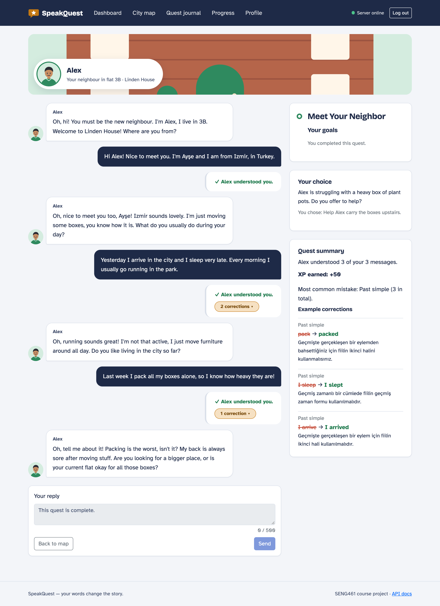
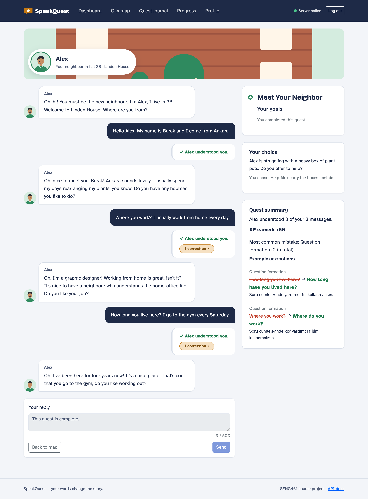
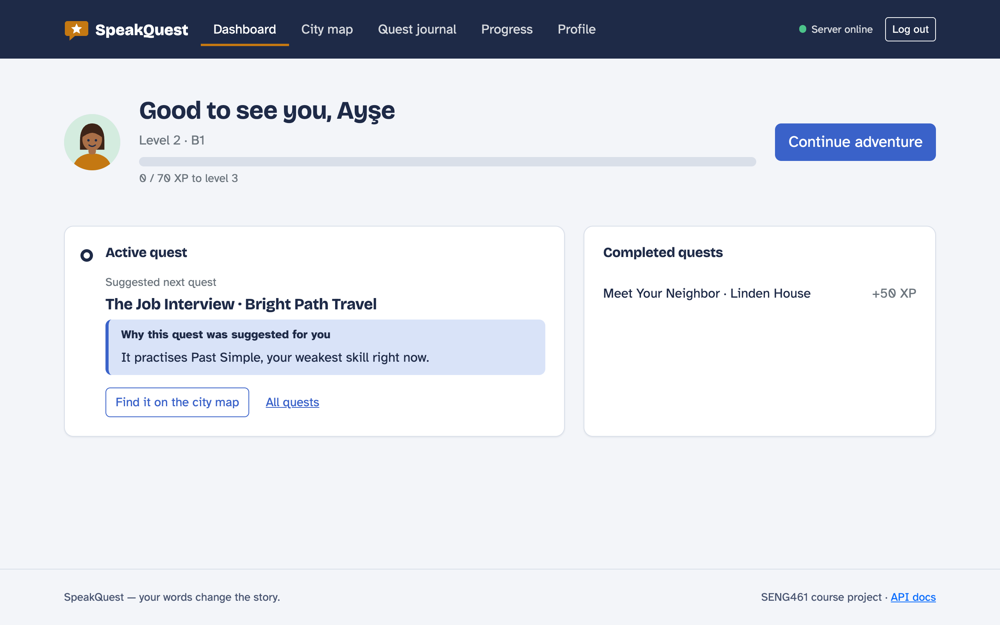
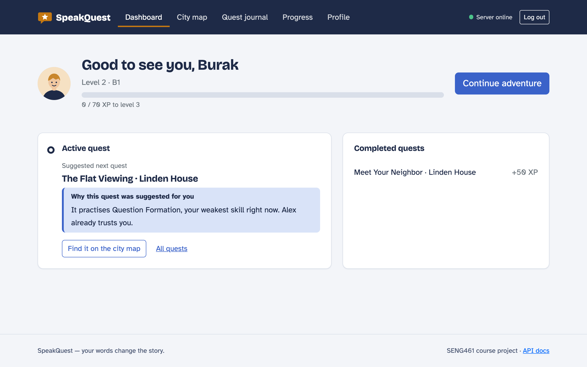
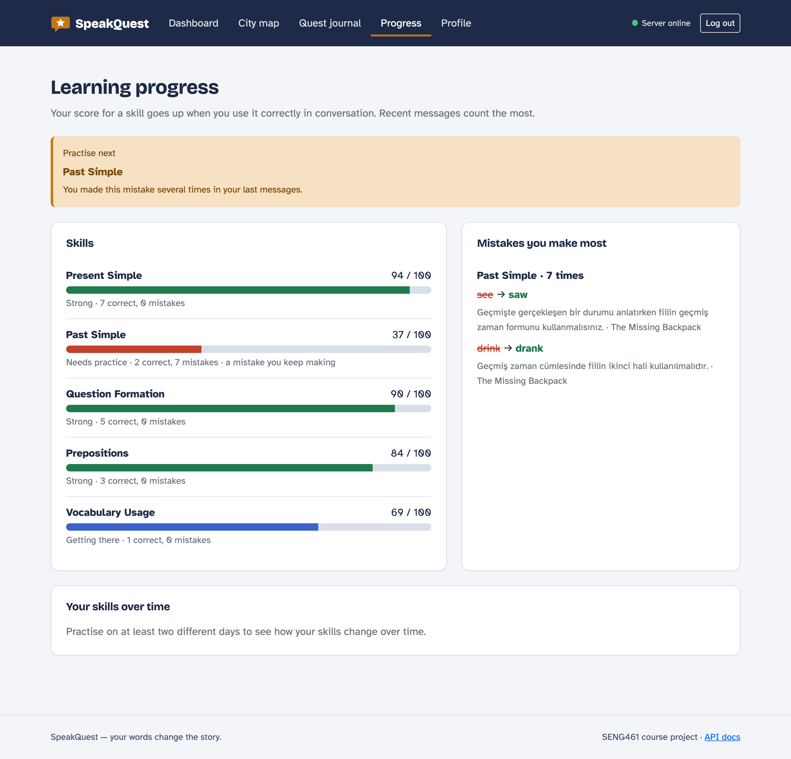
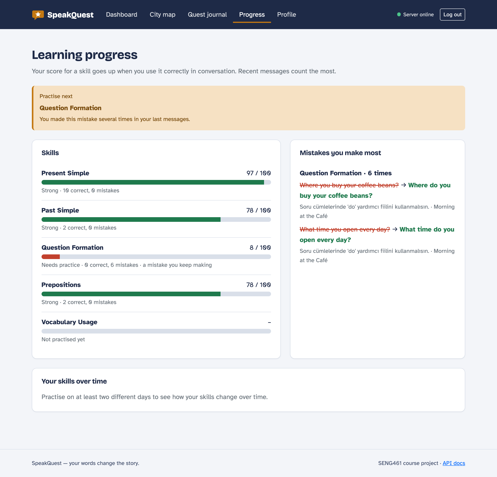
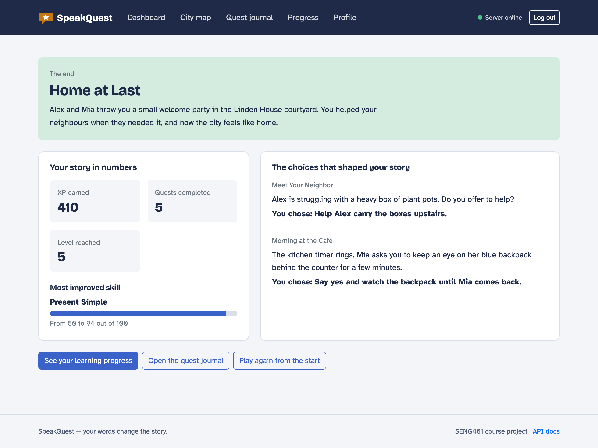
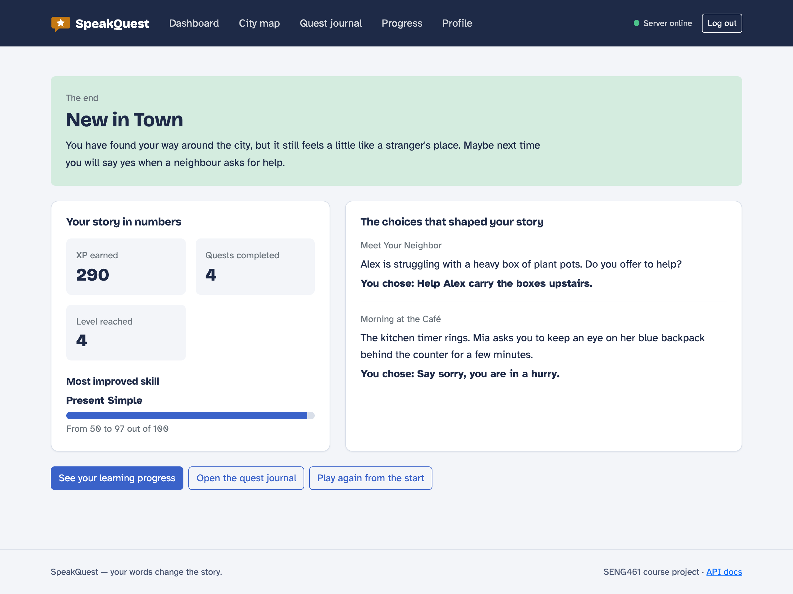
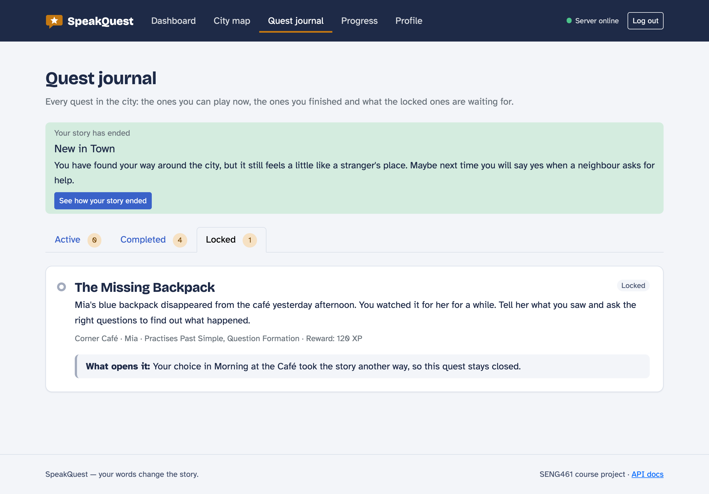
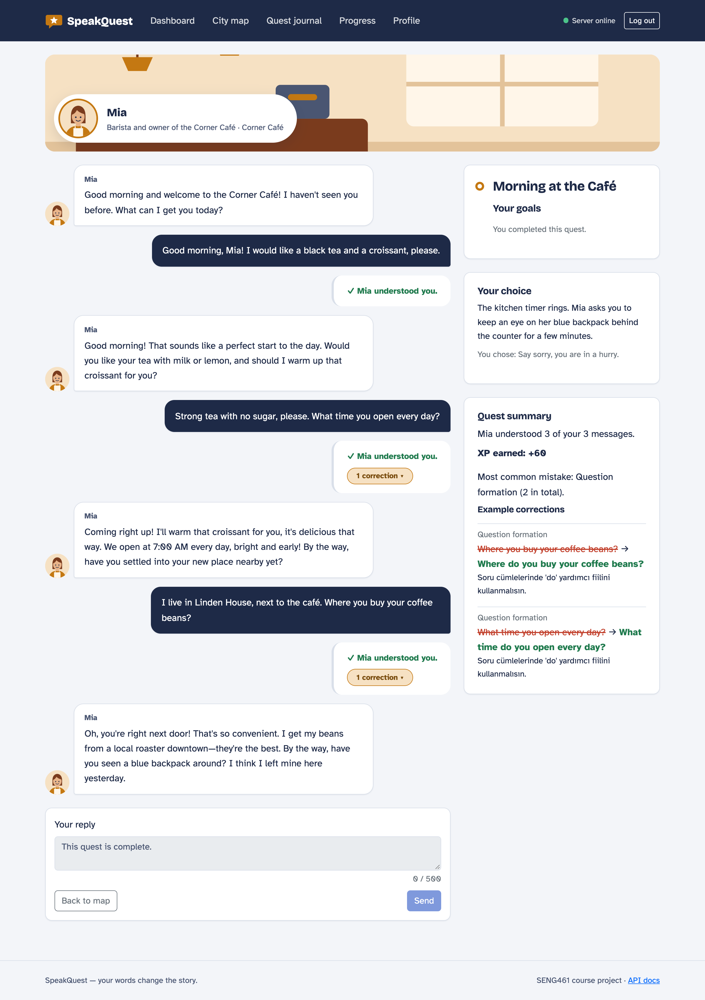

# Demo senaryosu

Sunumda gösterilecek senaryo: iki oyuncu aynı başlangıç görevini oynar. Biri **Past Simple**'da,
diğeri **Question Formation**'da hata yapar. Sistem bu farkı ilk görevden sonra fark eder ve iki
oyuncuya farklı görevler önerir. Mia'nın çantasıyla ilgili farklı kararları da onları iki farklı
hikâye sonuna götürür.

Senaryo gerçek AI (Gemini) ile iki kez baştan sona oynandı. İki oynanışta da öneri sırası ve sonlar
birebir aynı çıktı (bkz. [Gerçek AI ile oynanış](#gerçek-ai-ile-oynanış)).

## Hazırlık

1. `.env` içinde `AI_PROVIDER=gemini` ve `AI_API_KEY` dolu olmalı (README, "Kurulum ve Çalıştırma").
2. `docker compose up --build`, ardından <http://localhost:8000>.
3. İki ayrı tarayıcı penceresi açın (biri gizli pencere olabilir) ve iki hesap oluşturun.
4. Karakterleri aynı seviye ve hedefle oluşturun, böylece aradaki tek fark yazılan mesajlar olur:

| | Ayşe | Burak |
|---|---|---|
| Seviye | B1 | B1 |
| Öğrenme hedefi | Everyday conversation | Everyday conversation |
| Zorlandığı yapı | Past Simple (`Yesterday I go…`) | Question Formation (`Where you live?`) |
| Alex'in kutuları | Yardım eder | Yardım eder |
| Mia'nın çantası | Göz kulak olur | "Acelem var" der |
| Ulaştığı son | **Home at Last** | **New in Town** |

> Diyalog ekranında oyuncu başına dakikada en fazla 10 mesaj gönderilebilir. Normal hızda yazarken bu
> sınıra takılmazsınız.

## 1. Ortak başlangıç: Meet Your Neighbor

İki oyuncuya da ilk olarak aynı görev önerilir: _"It continues your story and practises Present
Simple."_ Haritadan **Linden House**'a girin. Sağdaki **Your choice** panelinde Alex'e yardım etmeyi
seçin (_"Help Alex carry the boxes upstairs."_).

| # | Ayşe yazar | Burak yazar |
|---|---|---|
| 1 | Hi Alex! Nice to meet you. I'm Ayşe and I am from Izmir, in Turkey. | Hello Alex! My name is Burak and I come from Ankara. |
| 2 | Yesterday I **arrive** in the city and I **sleep** very late. Every morning I usually go running in the park. | **Where you work?** I usually work from home every day. |
| 3 | Last week I **pack** all my boxes alone, so I know how heavy they are! | **How long you live here?** I go to the gym every Saturday. |

Beklenen: üç hedef de tamamlanır (`greet`, `introduce_yourself`, `describe_routine`). Ayşe'nin
mesajlarında 3 Past Simple düzeltmesi (_arrive → arrived, sleep → slept, pack → packed_), Burak'ın
mesajlarında 2 Question Formation düzeltmesi (_Where do you work?_, _How long have you lived here?_)
çıkar. Mesajlar anlaşıldığı için görev başarısız sayılmaz. Görevi tamamlayın (+50 XP).

| Ayşe: Past Simple düzeltmeleri | Burak: Question Formation düzeltmeleri |
|---|---|
|  |  |

## 2. Ayrışma: farklı öneriler

Görevden sonra iki oyuncu da **Dashboard**'a dönsün. Bu, sunumun ana anı:

| Ayşe | Burak |
|---|---|
| **The Job Interview** | **The Flat Viewing** |
| _"It practises Past Simple, your weakest skill right now."_ | _"It practises Question Formation, your weakest skill right now. Alex already trusts you."_ |

İki oyuncunun önünde aynı görevler açıktır. Seçimi yalnızca Learning Engine'in bulduğu zayıf beceri
belirler ([quest-engine.md](quest-engine.md), "Puanlama"). Aynı açıklama **Quest Journal**'da da
görünür.

| Ayşe | Burak |
|---|---|
|  |  |

## 3. Ayşe'nin yolu → Home at Last

Ayşe her zaman önerilen görevi oynar. Sıra: The Job Interview → The Flat Viewing → Morning at the
Café → The Missing Backpack.

**The Job Interview** (Bright Path Travel, Olivia)

1. Hello, I'm Ayşe. I am a university student from Izmir and I love travelling.
2. Last summer I **work** in a hotel in Bodrum. I **help** tourists and I **answer** the phone every day.
3. I want to work at Bright Path Travel because I love helping people plan their trips.

**The Flat Viewing** (Linden House, Alex). Öneri: _"It continues your story and practises Question
Formation. Alex already trusts you."_

1. How much is the rent for the flat?
2. How many rooms does it have? Are the bills included?
3. I need a quiet room for my work and a small kitchen. Last year I **live** in a very noisy flat.

**Morning at the Café** (Corner Café, Mia). **Your choice** panelinde Mia'nın çantasına göz kulak
olmayı seçin (_"Say yes and watch the backpack until Mia comes back."_).

1. Good morning, Mia! Can I have a cappuccino and a cheese sandwich, please?
2. With milk but no sugar, please. Yesterday I **drink** too much sugar at the station.
3. I live in Linden House, next to your café. Last night I **see** your lights from my window.

**The Missing Backpack** (Corner Café, Mia). Bu görev yalnızca çantaya göz kulak olan oyuncuya açılır.
Öneri: _"It practises Past Simple, a mistake you keep making. Mia already trusts you."_

1. Yesterday afternoon I **sit** at the table near the window and I **drink** a coffee. I **see** a man with a big red bag next to the counter.
2. When did you last see your backpack? Where was it exactly?
3. I think you should call the police and ask the shop next door for their camera video.

Sonuç: beş görevin hepsi tamamlanır ve hikâye **Home at Last** ile biter. Ayşe 410 XP ile 5.
seviyeye ulaşır. Learning Progress ekranında Past Simple "a mistake you keep making" olarak işaretlidir.

## 4. Burak'ın yolu → New in Town

Sıra: The Flat Viewing → Morning at the Café → The Job Interview.

**The Flat Viewing**

1. **How much the rent is** for this flat?
2. **How many rooms it has? The bills are included?**
3. I need a quiet place because I work from home. Last year I lived in a small flat near the station.

**Morning at the Café**. **Your choice** panelinde _"Say sorry, you are in a hurry."_ seçin.

1. Good morning, Mia! I would like a black tea and a croissant, please.
2. Strong tea with no sugar, please. **What time you open** every day?
3. I live in Linden House, next to the café. **Where you buy** your coffee beans?

**The Job Interview**

1. Hello, my name is Burak. I am a software developer from Ankara.
2. Last year I worked at a small travel agency. I organised trips for students and answered customer emails.
3. I want to work here because I enjoy travel and I like helping customers.

Sonuç: Burak çantaya göz kulak olmadığı için **The Missing Backpack** hiç açılmaz. Quest Journal'da
kilit nedeni şöyle görünür: _"Your choice in Morning at the Café took the story another way, so this
quest stays closed."_ Hikâye dört görevden sonra **New in Town** ile biter (290 XP, 4. seviye).

## 5. Gösterilecek farklar

| | Ayşe | Burak |
|---|---|---|
| İlk görevden sonraki öneri | The Job Interview | The Flat Viewing |
| Oynanan görevler | 5 | 4 |
| En zayıf beceri (Learning Progress) | Past Simple (37/100, tekrar eden hata) | Question Formation (8/100, tekrar eden hata) |
| Son | Home at Last | New in Town |

| Ayşe – Learning Progress | Burak – Learning Progress |
|---|---|
|  |  |

| Ayşe – Home at Last | Burak – New in Town |
|---|---|
|  |  |

## Gerçek AI ile oynanış

Senaryo 1 Kasım 2026'da yerel ortamda gerçek Gemini API'siyle iki kez baştan sona oynandı. Her
oynanışta yukarıdaki mesajlar UI'ın kullandığı API çağrılarıyla aynen gönderildi; yedek mesaja hiç
gerek kalmadı.

| Oynanış | Öneri sırası (ilk görevden sonra) | Mesaj | Anlaşılan | Yakalanan hata | Son |
|---|---|---|---|---|---|
| Ayşe, 1. | Job Interview → Flat Viewing → Café → Missing Backpack | 15 | 15 | 12/12 Past Simple | Home at Last |
| Ayşe, 2. | Job Interview → Flat Viewing → Café → Missing Backpack | 15 | 15 | 12/12 Past Simple | Home at Last |
| Burak, 1. | Flat Viewing → Café → Job Interview | 12 | 12 | 6/6 Question Formation | New in Town |
| Burak, 2. | Flat Viewing → Café → Job Interview | 12 | 12 | 6/6 Question Formation | New in Town |

- Her görevin bütün hedefleri senaryodaki üç mesajla tamamlandı.
- Başka kategoride yanlış düzeltme çıkmadı. Ayşe'nin doğru kurduğu sorular ve Burak'ın doğru
  kullandığı Past Simple doğru olarak sayıldı.
- NPC cevapları her oynanışta farklı kelimelerle gelir. Öneriler, düzeltmeler ve sonlar ise aynı kaldı.

## Sunum ipuçları

- **Skills over time** grafiği en az iki farklı günde pratik ister. Aynı gün oynanan demoda grafik
  yerine _"Practise on at least two different days…"_ yazısı görünür. Grafiği göstermek istiyorsanız
  hesapları bir gün önceden açıp ilk görevi oynayın.
- Bir hesabı baştan oynatmak için **Profile → Reset game progress** kullanın. Hesap ve karakter kalır.
- AI cevabı bazen birkaç saniye sürer. Bu sırada _"Sending…"_ görünür.
- Bilinen hatalar aşağıdadır. [#64](https://github.com/emirulasozdag/SPEAKQUEST/issues/64) düzelmeden sunum yapılırsa Mia, Café görevinde çantadan bahsedebilir.

## Oynanış sırasında bulunan hatalar

- [#64](https://github.com/emirulasozdag/SPEAKQUEST/issues/64): Mia, çanta henüz kaybolmamışken Morning at the Café görevinde kaybolduğundan bahsediyor. Dört
  oynanışın dördünde de görüldü; çantaya göz kulak olmayı reddeden oyuncuya da oluyor.
  
- [#65](https://github.com/emirulasozdag/SPEAKQUEST/issues/65): Kilitli görevlerin özetleri, oyuncunun vermediği kararı varsayıyor. Örneğin çantaya göz kulak
  olmayan Burak'ın Quest Journal'ında The Missing Backpack için _"You watched it for her for a
  while."_ yazıyor.
